# Gemini — A Visual Product Walkthrough

Gemini is presented as a personal space for asking questions, exploring ideas, and keeping conversations together. This tour follows the experience from the public homepage through account access, then explains how conversations, account settings, and the Pro plan fit together.

> **What these screens are:** the public pages are captured from the frontend, and the signed-in screenshots come from a separate local end-to-end run using the actual FastAPI backend, a disposable PostgreSQL database, and a real Redis server. The production Render API is still suspended, so the authenticated test uses isolated local test data, not production user records. The user message is real and persisted; a model-generated answer was not produced because the test environment has no valid OpenAI credential.

## The experience at a glance

The journey begins with a public introduction, continues through mobile-number sign-in or account creation, and is intended to lead into a saved AI chat workspace. Conversations are stored in PostgreSQL. Redis is used for conversation caching, message queueing and Basic-plan limits; the background worker currently calls OpenAI's `gpt-3.5-turbo` model despite the Gemini product branding.

## 1. Discover the space

### The homepage

The homepage explains the product before asking the visitor to create an account. The navigation links jump to Features, Preview and About. **Get started** and **Start exploring** open account creation; **Log in** opens the returning-user flow.

The call to action is deliberately clear: a visitor can look around first, then create an account when they are ready.

### Features: the kinds of things you can explore

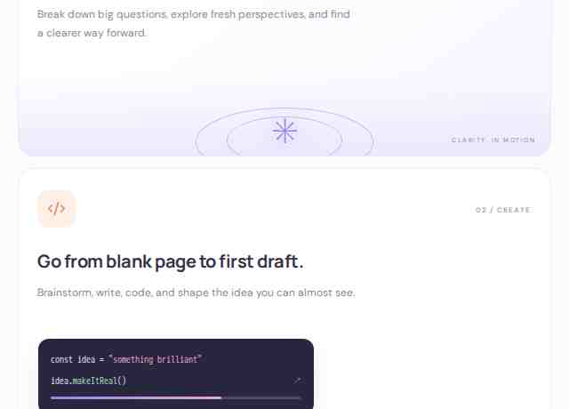

This section describes the product's intended role as a place to untangle questions, plan, and develop ideas. These are introductory product claims, not separate backend modules: the actual assistant answer only exists when a signed-in request reaches the API and the AI worker completes it.

### Preview: choose a place to begin

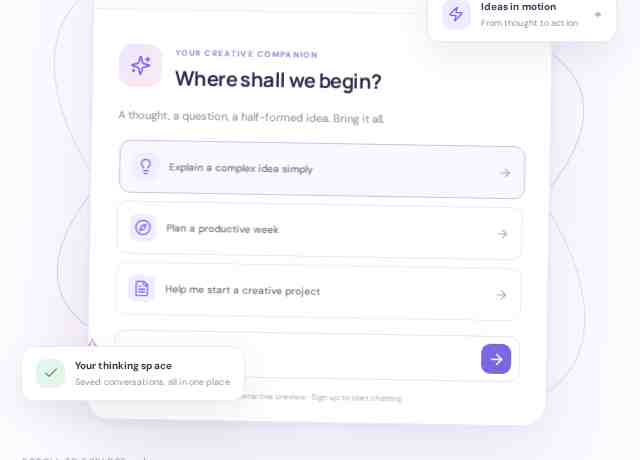

The preview lets a visitor select a suggested prompt to see a starting point. The preview is intentionally a doorway, not a live AI conversation. Selecting **Meet your AI** or the send arrow asks the visitor to create an account before starting a real chat.

### Ready to begin

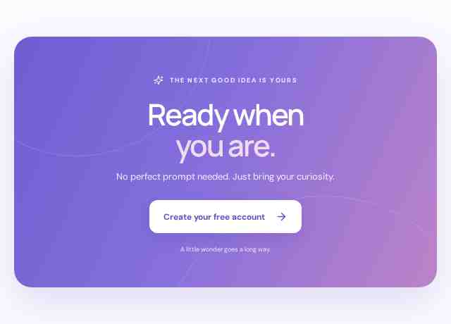

The final invitation leads back to the same account-creation journey. The idea is simple: a visitor can browse the page, understand the product, and enter through one consistent account flow.

## 2. Create an account

### Account creation

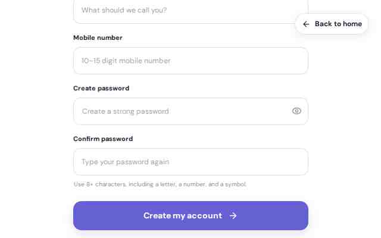

The form asks for a mobile number, password and confirmation. A name can be provided so the workspace can greet the user personally.

Behind the screen, the frontend is intended to send `POST /auth/signup`. The backend validates the submitted fields, checks that the mobile number is not already registered, hashes the password, writes a user record to PostgreSQL, and returns an access token. The frontend then uses that token to load the user's profile, conversation history and subscription tier.

Account creation **was verified locally through the real browser and backend**: `POST /auth/signup` returned successfully, the response token was stored by the frontend, and the profile endpoint returned the newly created test profile from PostgreSQL. The production API remains suspended; these are separate local test records, not production registrations.

### What happens when the form is incomplete?

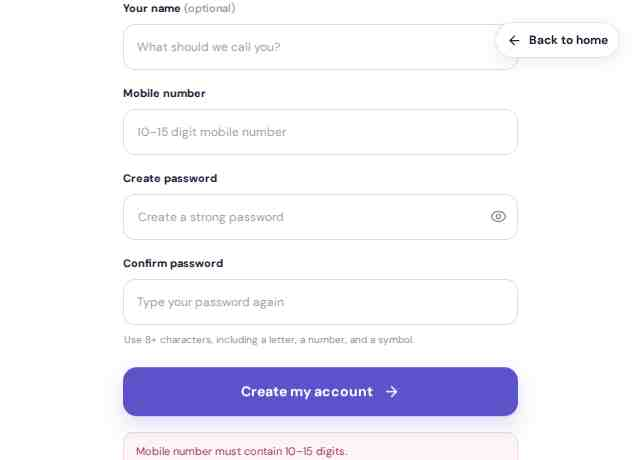

The form checks entries before attempting an account-creation request. This is useful feedback for a visitor, but browser-side validation is only the first layer: the backend schema and database constraints must still reject invalid input and duplicate mobile numbers.

### Returning to sign in

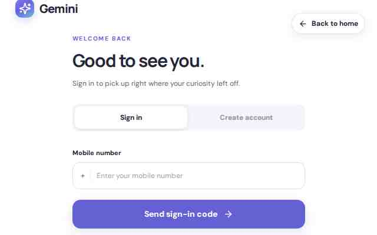

Sign-in uses a mobile number and a one-time code rather than a password entry screen. The local browser run completed `POST /auth/send-otp` and `POST /auth/verify-otp`, stored the returned bearer token, and loaded the profile and recent-chat list through the protected APIs.

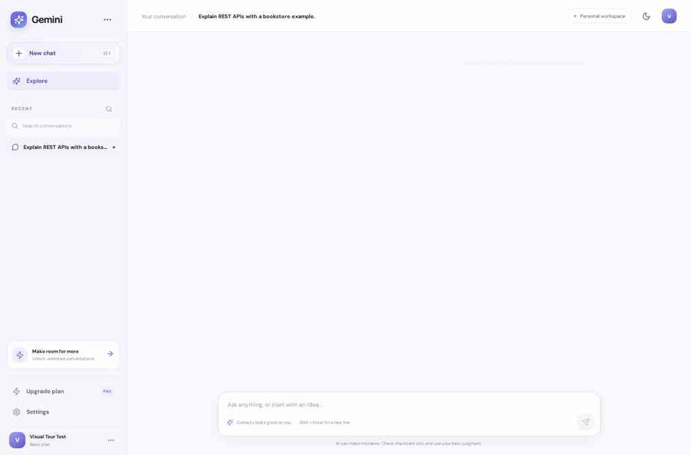

The saved “Explain REST APIs with a bookstore example.” conversation reappeared after this fresh sign-in, and opening it loaded the same message from the backend. This verifies that a returning session can recover a previously saved room after authentication, rather than relying on the old browser tab's in-memory state.

### Invalid mobile number

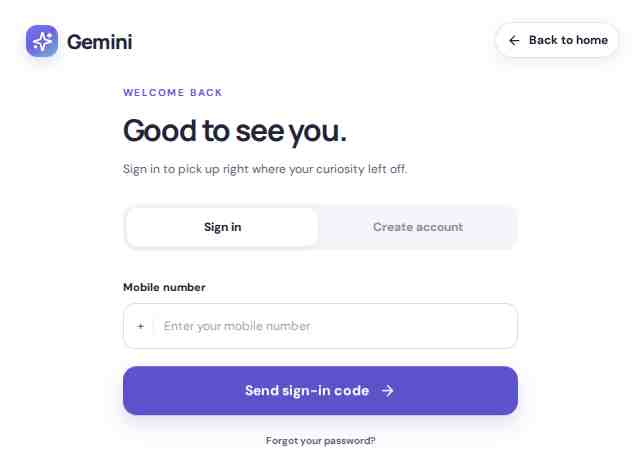

The interface checks the mobile number format before requesting a code. In the local integrated run, `POST /auth/send-otp` and `POST /auth/verify-otp` completed the returning-user login and the app loaded the authenticated workspace. The implementation currently exposes the test OTP in the response/client UI; that is a production security concern and should be replaced with secure out-of-band delivery.

The production API is still manually suspended by Render, so the existing production failure capture below remains useful context. It shows the real HTTP 503 route failure, not an OTP rejection.

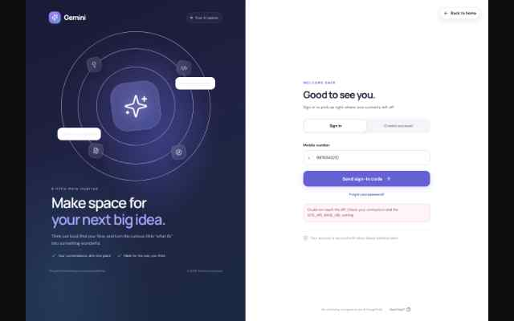

## 3. Recover account access

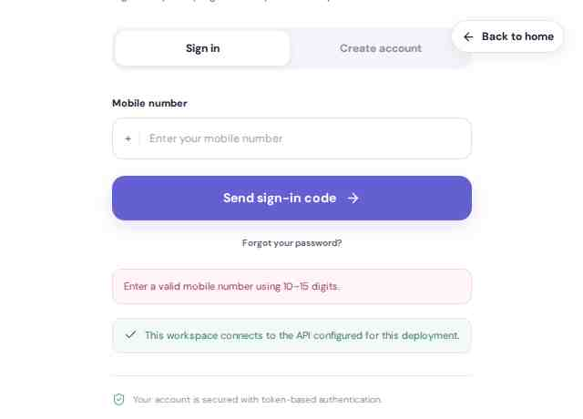

The **Need help?** entry opens recovery. The intended sequence is to submit a mobile number, verify a one-time code, and choose a new password.

The backend routes are `POST /auth/forgot-password` and `POST /auth/reset-password`. The signed-in Security panel also uses `POST /auth/change-password` for users who know their current password. The backend configures a five-minute OTP expiry and a maximum of five incorrect attempts.

This recovery journey could not be completed against the suspended production API. The repository currently documents the OTP response as a development/test flow that returns the code to the client. Before production use, that code must be delivered through a real, separate channel rather than returned in the API response.

## 4. Inside the chat workspace

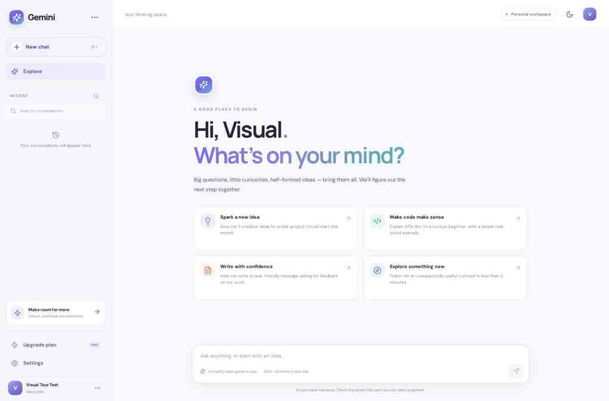

This is the actual signed-in interface, not a designed mockup. The local end-to-end run created a test account through the signup form; the UI then loaded that account's profile from `GET /user/user/me`, its plan from `GET /subscribe/subscription/status`, and its recent rooms from `GET /ChatRoom/chatroom`. The visible profile name and Basic tier came from the test backend/database.

A signed-in user gets a sidebar for recent conversations, a central conversation area, a message composer, starter prompts and account controls. Enter submits a question, while Shift+Enter inserts a new line.

### Start a conversation and save a real message

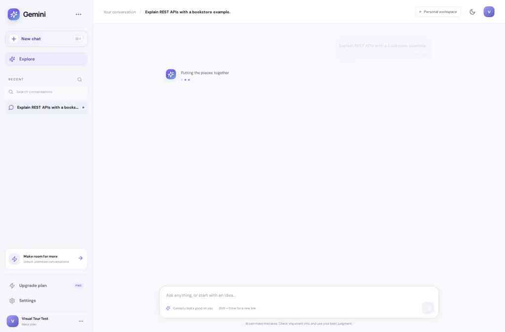

The browser sent the real prompt “Explain REST APIs with a bookstore example.” The frontend created the room through `POST /ChatRoom/chatroom`, then submitted the message through `POST /message/{chatroom_id}/message`. Both returned HTTP 200 in the local integrated test. PostgreSQL confirmed a corresponding `chatrooms` row and `chat_messages` row; the message job also appeared in Redis `openai_chat_queue`.

The screenshot shows the app waiting for a reply. **The assistant answer itself was not verified:** the test used no valid OpenAI key and the background worker was intentionally not run against a fake credential. No AI-generated content has been invented or inserted into the database to make the screenshot look complete.

### Reopen the saved conversation

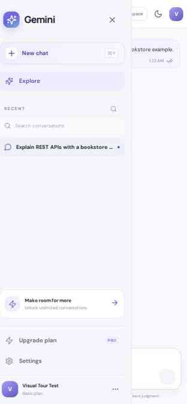

After reloading the frontend, the recent-room list contained the saved room. Opening it called `GET /ChatRoom/chatroom/{chatroom_id}`, and the same user message appeared again. This confirms the browser → API → PostgreSQL write/read path for a saved user message rather than only an in-memory frontend state.

The recent-room cache also needed a correction: newly created rooms now invalidate the per-user Redis cache so an earlier cached empty list does not hide the new room after reload.

### Return to the workspace

The sidebar's **New chat** action clears the current view, not the saved room. Selecting a recent item reopens its stored history. Search filters the room list already loaded in the browser; it is not a separate server-side search route.

## 5. Your account, security and plan

### Account details and appearance

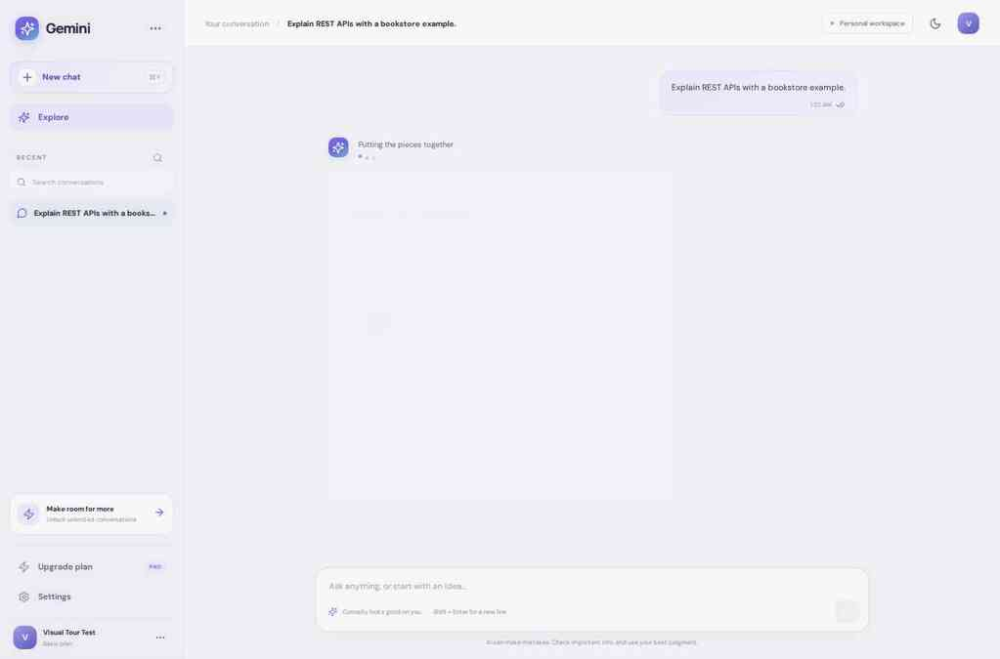

The Account panel displays the same profile and Basic tier fetched from the local backend. The theme button switches between light and dark appearance and persists the preference in browser local storage under `gemini_theme`; this preference is local to the browser, not a PostgreSQL setting.

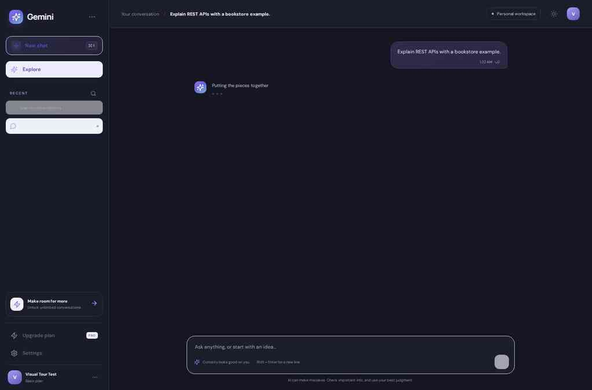

### Security

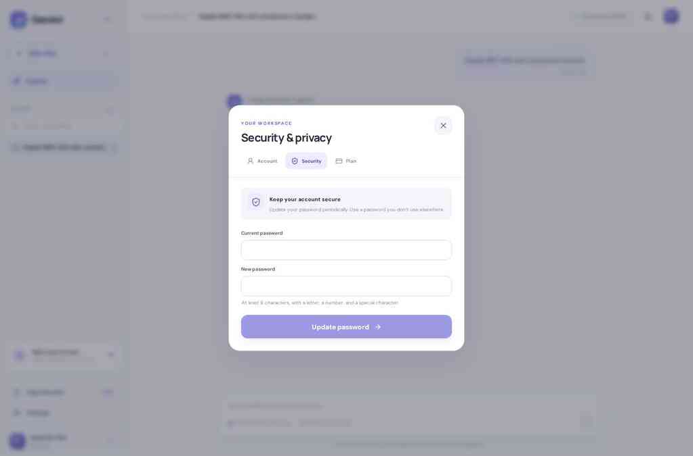

The Security panel submits the current and new password to `POST /auth/change-password`. The frontend checks for at least eight characters, a letter, a number, and a special character before sending. The panel was opened and captured, but no password was changed during this walkthrough.

### Basic and Pro

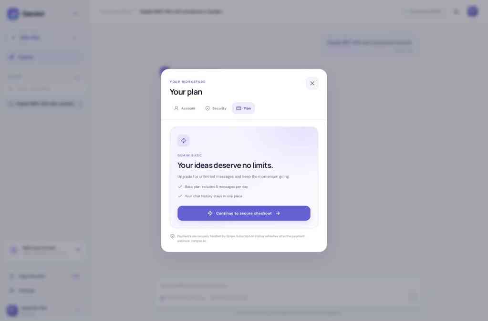

The Plan panel reads `GET /subscribe/subscription/status` and shows the account's stored tier. Basic is described in the code as allowing five messages per day; Pro removes that product limit. The upgrade action calls `POST /subscribe/pro` and redirects to the returned Stripe Checkout URL.

After checkout, `POST /subscribe/webhook/stripe` is intended to verify the Stripe signature and update the user's `subscription_tier` after a completed session. No checkout or live payment was initiated, so a paid upgrade is not represented as tested.

### Is there a separate admin workspace?

The inspected frontend and backend do not expose a separate administrator dashboard, administrator role, or admin-only API group. The tour therefore follows the user-facing product that exists in these repositories.

## 6. The data behind the experience

The backend migrations define four PostgreSQL tables:

| Table | What it stores |
| --- | --- |
| `users` | Mobile number, password hash, OTP metadata, verification status and subscription tier |
| `chatrooms` | Conversation title and owning user |
| `chat_messages` | User and assistant messages linked to a room |
| `migrations` | Applied SQL migration filenames and timestamps |

The actual backend was started against a disposable local PostgreSQL database and a local Redis server. Migrations created all four tables. The real browser flow then created users, chatrooms and chat messages through the API; a subsequent database query confirmed rows in all three application tables. The protected profile, room list, room detail, subscription status and message routes also returned HTTP 403 when tested without a bearer token. These were isolated test records and did not change production user or payment data.

Relevant implementation: [database migrations](https://github.com/faizansaiyed123/gemini-backend-clone/tree/main/src/database), [chatroom service](https://github.com/faizansaiyed123/gemini-backend-clone/blob/main/src/services/chatroom_service.py), [message service](https://github.com/faizansaiyed123/gemini-backend-clone/blob/main/src/services/message_service.py), [background worker](https://github.com/faizansaiyed123/gemini-backend-clone/blob/main/src/services/worker.py).

## 7. A smaller screen

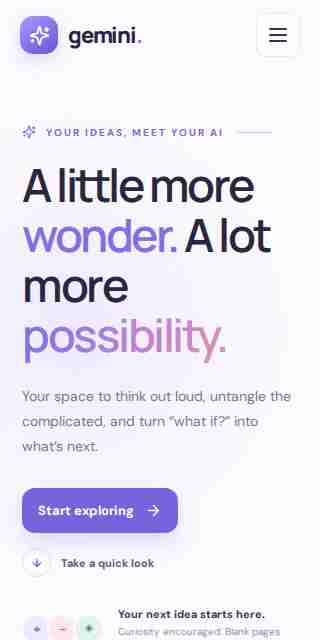

The homepage adapts to a narrow viewport and keeps the main call to action in view.

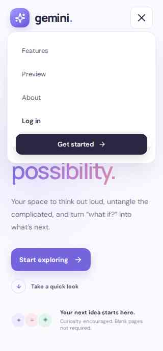

The navigation menu expands and exposes the page links on mobile.

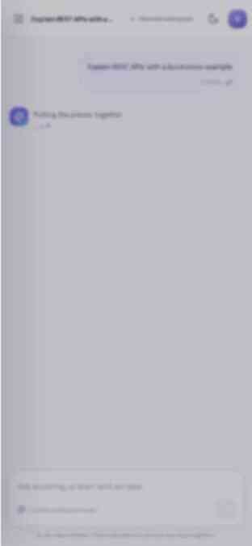

This authenticated mobile capture shows the real saved conversation in the sidebar. The browser reloaded the room list from the local API and could open the saved message at the narrow viewport, not just the public navigation menu.

## 8. A few implementation details worth knowing

- **The product name and model provider differ.** The backend worker calls OpenAI `gpt-3.5-turbo`; it does not call Google's Gemini API.
- **OTP is development-oriented today.** The current backend returns an OTP to the client; this should be replaced with secure out-of-band delivery for production.
- **The actual chat path exposed a startup race.** On the first integrated run, concurrent requests could reach lazy SQLAlchemy table reflection together and the message insert failed with “Unconsumed column names”. The backend now reflects the user, room and message tables immediately after migrations, before accepting requests. The subsequent integrated browser run successfully submitted and persisted the message.
- **The recent-room cache needed invalidation.** Creating a room now clears the user's cached recent-room list so reloading does not keep showing a stale empty list. This was verified by reloading the frontend and opening the saved room again.
- **Queue delivery still needs stronger failure handling.** The queue helper logs exceptions without propagating them, so a saved message can be left without a queued job. A durable retry/outbox design remains open.
- **Other backend hardening is on main.** The Basic-plan limiter uses a synchronous Redis client while chatroom caching keeps the async client. Stripe webhook requests with missing or invalid signatures return HTTP 400; the missing-signature case was retested locally. Live Stripe checkout and a successful real model response are not verified.
- **OTP remains development-oriented.** The backend returns the one-time code to the client. Production should deliver codes through a separate secure channel instead.

## Where the tour can continue

The local integrated run now covers registration, bearer-token profile loading, subscription status, room creation, message submission, PostgreSQL persistence, Redis queue insertion, history reload and reopening a saved message. The Account, Security and Plan screens are captured with the real local test profile.

Two end-to-end legs still need valid production-like provider credentials and services: the worker must consume the queued job and return a genuine OpenAI answer, and a Stripe test checkout must be completed and verified by its signed webhook. The production Render API is currently suspended, so neither those steps nor the live deployed flow has been verified. The screenshots don't pass off a test spinner as an AI answer or a displayed plan as a completed payment.
