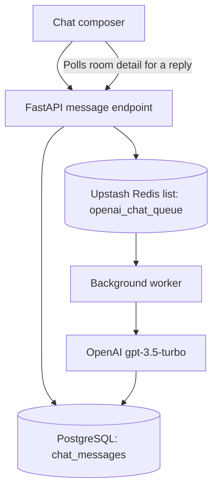

# Gemini Clone — Visual Full-Stack Walkthrough

> **Verification date:** 25 October 2026  
> **Scope:** production frontend, frontend build, backend route contract, an isolated FastAPI + PostgreSQL run, and source-to-database flow mapping.  
> **Reading this document:** this is a product walkthrough with evidence and a tracked test checklist. It does **not** mark unexecuted flows as passed.

The goal is to follow the application as a person would use it, then show what the frontend calls, what the backend is intended to do, and where data is stored. The format follows the user-journey style of the [AutoFix visual walkthrough](https://github.com/faizansaiyed123/autofix_frontend/blob/main/docs/testing/VISUAL-TEST-WALKTHROUGH.md).

## The product at a glance

Gemini Clone is an AI chat workspace with mobile-number OTP authentication, saved conversations, asynchronous assistant responses, account settings, password management, and a Basic/Pro subscription flow. Despite the Gemini branding, the backend source currently calls **OpenAI `gpt-3.5-turbo`**, rather than Google's Gemini API.

### Verified status at a glance

| Area | Evidence-backed result |
| --- | --- |
| Production frontend | **Passed.** The live Vercel homepage loaded successfully. |
| Frontend production build | **Passed.** `npm run build` completed, including TypeScript checking and Vite bundling. |
| Landing page and responsive navigation | **Passed.** Real browser checks and screenshots are included below. |
| Client-side signup validation | **Passed.** A weak/mismatched password was rejected before any API request was sent. |
| Backend deployment | **Blocked.** The configured Render URL returned HTTP **503**, with `x-render-routing: suspend-by-user`; the service is suspended by its owner. |
| Local backend route guards | **Passed.** Protected endpoints rejected requests without a token; no user, room, or message rows were written. |
| Local database migrations | **Passed.** The backend startup migration created the four expected tables in disposable PostgreSQL. |
| Redis rate-limiter client fix | **Applied to backend main.** A focused isolated logic check allowed five messages and rejected the sixth; real Upstash integration still needs a live test. |
| Stripe webhook error-status fix | **Applied to backend main.** The missing-signature case returned HTTP 400 in the isolated backend. Valid signed delivery is not yet tested. |
| Authenticated chat, AI, account, and Stripe flows | **Not verified end to end.** The suspended deployment and missing real provider connectivity prevent honest confirmation. |

**Important boundary:** the isolated test database was not a production database. No production data was created or altered. Successful checks below are specific to the behavior stated beside each result.

## 1. Entering the application

### Public homepage

The homepage is available without a session. Its navigation exposes Features, Preview, About, Log in, and Get started. The primary call to action opens the account-creation flow.

**Verified in a real browser:** the production URL returned HTTP 200, the page title was “Gemini — Think it through”, the homepage text rendered, and the Get started interaction opened the account form.

[Open the deployed frontend](https://gemini-frontend-clone.vercel.app/) · [Frontend source](https://github.com/faizansaiyed123/gemini-frontend-clone)

### Creating an account

The form collects a name, mobile number, password, and confirmation. In the exercised invalid-input case, the browser displayed validation feedback and sent **zero** requests to the backend. This validates the guard on that specific invalid case; it does not prove that a real registration successfully commits to the database.

The intended full flow in the code is:

1. The browser submits `POST /auth/signup`.
2. The backend validates the payload, checks for an existing mobile number, hashes the password, inserts a `users` row, commits the transaction, and returns an access token.
3. The frontend stores the token and loads the current profile, chat list, and subscription status.

The registration write was **not** run in the production environment because its backend is suspended and an authenticated database write could not be verified safely. The isolated database was left empty after the negative tests.

### Signing in and the live integration blocker

The sign-in screen requests an OTP for the supplied mobile number. The browser attempted the real request `POST /auth/send-otp` against the configured production API; it did not receive an application response. The backend host returned a Render suspension page with HTTP 503 and no CORS response headers, so the browser reported a CORS/preflight failure and `net::ERR_FAILED`.

This is **not** evidence that OTP validation failed inside FastAPI: the suspended service did not serve the request to the application. No successful OTP, token issuance, or sign-in is claimed.

### Smaller screens

The responsive landing page and navigation toggle were exercised at a mobile viewport. The menu opened and the Features link became visible. The authenticated mobile chat sidebar cannot be validated fully until an authenticated session can be established.

## 2. Authentication and account access

The route list below is taken from the frontend API calls and backend router definitions, rather than inferred from the screen labels.

| User journey | API contract | Backend/data behavior | Test status |
| --- | --- | --- | --- |
| Create an account | `POST /auth/signup` | Validates fields, rejects duplicate mobile numbers, bcrypt-hashes password, inserts `users`, returns a token | **Not run end to end** |
| Request sign-in code | `POST /auth/send-otp` | Stores OTP and resend/attempt metadata; current implementation describes the OTP flow as mocked | **Live request blocked by suspended service** |
| Verify code / sign in | `POST /auth/verify-otp` | Checks stored code, expiry and attempt limit; returns token on success | **Not run end to end** |
| Request password recovery | `POST /auth/forgot-password` | Initiates the OTP recovery flow | **Not run end to end** |
| Reset password | `POST /auth/reset-password` | Updates a password after the OTP verification token is supplied | **Not run end to end** |
| Change password | `POST /auth/change-password` | Authenticated password update; validates the new password contract | **Not run end to end** |
| Load account profile | `GET /user/user/me` | Reads the signed-in user from PostgreSQL | **Unauthenticated guard verified; signed-in result blocked** |
| Sign out | Client-side token clearing | Removes the frontend token and clears profile/chat state | **Source reviewed; complete authenticated lifecycle blocked** |

The backend settings specify a five-minute OTP expiry and a maximum of five incorrect attempts. The frontend validates that a new password is at least eight characters and includes a letter, number, and special character; server-side validation also needs to be exercised once the service is available.

**Security note from the repository's own implementation:** OTP delivery is currently mocked and the OTP is returned in the API response for the UI to display as a test code. That must be replaced with a real, secure out-of-band delivery flow before treating this as production-grade authentication. See the [backend README](https://github.com/faizansaiyed123/gemini-backend-clone#readme) and [authentication service](https://github.com/faizansaiyed123/gemini-backend-clone/blob/main/src/services/auth_service.py).

## 3. Chat workspace and saved conversations

The intended authenticated journey starts with the frontend loading the current user, recent rooms, and subscription tier. Creating a conversation and loading its history use the real API contracts below.

| Action in the UI | API | Data operation in source | Test status |
| --- | --- | --- | --- |
| Load conversation list | `GET /ChatRoom/chatroom` | Reads rooms owned by the authenticated user; Redis is used as a room-list cache | **Unauthenticated guard verified; authenticated data blocked** |
| Start a new chat | `POST /ChatRoom/chatroom` | Inserts a `chatrooms` row linked to the current user | **Not run end to end** |
| Open an existing chat | `GET /ChatRoom/chatroom/{chatroom_id}` | Reads a room and its messages, scoped to the current user | **Unauthenticated guard verified; authenticated data blocked** |
| Send a message | `POST /message/{chatroom_id}/message` | Checks plan allowance, checks room ownership, stores a user message, then enqueues work | **Unauthenticated guard verified; successful write blocked** |
| Reload recent conversations | Room-list and room-detail GET calls | Rehydrates the sidebar/history and selected conversation | **Not run end to end** |
| Search history | Local filter over rooms already loaded | Filters room names in the browser; it is not a server-side search endpoint | **Source reviewed** |
| Send with keyboard | Enter submits; Shift+Enter inserts a newline | Browser interaction only, followed by the same send API | **Source reviewed** |
| Copy assistant response | Clipboard API | Copies the rendered response to the clipboard | **Source reviewed** |
| Light/dark theme | Browser local storage | Stores `gemini_theme`; does not write to PostgreSQL | **Source reviewed** |

The chatroom APIs are protected with a bearer token. In the isolated local run, requests without credentials to the profile, room list, room detail, subscription status, and message endpoint all returned **HTTP 403 — Not authenticated**. The isolated PostgreSQL counts remained `users = 0`, `chatrooms = 0`, and `chat_messages = 0` after these negative checks.

## 4. What happens after Send

The message path is designed to separate the fast user-message write from the slower assistant response:

The source code indicates this sequence:

1. If no room is selected, the frontend first creates a chatroom using the first part of the prompt as its title.
2. The backend stores the user message in `chat_messages`.
3. The backend pushes the message payload to the Redis list `openai_chat_queue`.
4. A background worker reads the queue and calls OpenAI `gpt-3.5-turbo`, then stores the assistant response.
5. The frontend polls room details every 1.8 seconds, up to 24 attempts, looking for a newly added AI message.

**This workflow has not passed an end-to-end test.** The live backend is suspended; the local integration runtime used invalid, test-only Redis and OpenAI settings, so it was not possible to assert a successful queue round-trip, model response, or persisted assistant reply. No AI response is fabricated for this walkthrough.

Relevant code: [message service](https://github.com/faizansaiyed123/gemini-backend-clone/blob/main/src/services/message_service.py), [queue implementation](https://github.com/faizansaiyed123/gemini-backend-clone/blob/main/src/queue/queue.py), [worker](https://github.com/faizansaiyed123/gemini-backend-clone/blob/main/src/services/worker.py).

## 5. Account settings, security, and plan

These views are present in the frontend source. Their authenticated API results and external provider steps remain unverified while the production backend is unavailable.

### Account details and sign out

The account panel reads the current user's full name, mobile number, verification status, and current subscription tier. Sign out removes the `gemini_token` browser storage entry and clears the current profile, room list, and messages. **Code-reviewed; not verified with a signed-in production account.**

### Password change

The Security tab submits `POST /auth/change-password` with the current and new password. The UI checks basic password composition before sending; the server is responsible for authenticating the token and applying the password change. **No password was changed during this run.**

### Basic and Pro plans

The frontend requests `GET /subscribe/subscription/status` to display the plan. Selecting the upgrade action sends `POST /subscribe/pro`, expects a `checkout_url`, and redirects the browser to Stripe Checkout. The webhook route `POST /subscribe/webhook/stripe` is intended to verify Stripe's signature and update `users.subscription_tier` after `checkout.session.completed`.

- Basic tier: the code intends to limit users to five messages per day.
- Pro tier: the UI describes unlimited messages.
- Checkout creation, paid subscription, cancellation return, successful webhook verification, and subsequent database tier update were **not exercised**. No live payment was initiated.

## 6. Database and persistence

The backend migration files define these PostgreSQL tables:

| Table | Purpose |
| --- | --- |
| `users` | Mobile number, password hash, OTP metadata, verification status, and subscription tier |
| `chatrooms` | Conversation title and owning user |
| `chat_messages` | User and assistant messages linked to a conversation |
| `migrations` | Migration filenames and execution timestamps |

The actual backend was started against a **disposable local PostgreSQL instance**. Its startup migration completed and `psql` confirmed that `users`, `chatrooms`, `chat_messages`, and `migrations` existed. That proves schema initialization in this isolated environment; it does **not** prove CRUD correctness or inspect the suspended service's production database.

Migration source: [V1 users](https://github.com/faizansaiyed123/gemini-backend-clone/blob/main/src/database/V1__create_users_table.sql), [V2 chatrooms](https://github.com/faizansaiyed123/gemini-backend-clone/blob/main/src/database/V2__chatroom.sql), [V3 messages](https://github.com/faizansaiyed123/gemini-backend-clone/blob/main/src/database/V3__chatroom_messages.sql), [V4 OTP metadata](https://github.com/faizansaiyed123/gemini-backend-clone/blob/main/src/database/V4__added_column_user.sql).

## 7. API and feature coverage checklist

**Legend:** ✅ verified for the stated assertion · ⚠️ defect or blocker found · 🟡 reviewed in source only · ⛔ full flow not run because a prerequisite is unavailable.

| Feature / check | Status | Evidence / next condition |
| --- | --- | --- |
| Production homepage and page title | ✅ | Live Vercel page loaded; screenshot above |
| Get started opens account creation | ✅ | Real browser interaction |
| Invalid signup password confirmation | ✅ | Client-side validation; zero API calls for this invalid case |
| Responsive landing navigation | ✅ | Real mobile viewport and menu-open screenshot |
| Frontend type-check and production build | ✅ | `npm run build` passed |
| Live `POST /auth/send-otp` | ⚠️ | Browser attempted the request; Render suspension page prevented the API app from responding |
| Signup row + password hash + returned JWT | ⛔ | Needs a functioning backend and a controlled test account |
| OTP verification and expiry/attempt cases | ⛔ | Needs the functioning auth service and delivery contract |
| Forgot/reset/change password | ⛔ | Authenticated database-backed lifecycle not run |
| Protected profile/room/message/subscription paths | ✅ | Unauthenticated local calls returned 403; no writes |
| Create/list/open conversation as a signed-in user | ⛔ | Requires an authenticated session against a working backend |
| Persist message + queue + assistant reply | ⛔ | Redis/OpenAI production round-trip not available |
| Basic-plan 5-message rate limit | 🟡 | Client selection and five/six boundary logic tested in isolation; live Upstash remains to be retested |
| Search, clipboard, theme persistence, keyboard composer | 🟡 | Present in frontend source; not all interactions were executed |
| Account profile and plan display | ⛔ | Requires successful profile/subscription API reads |
| Stripe Checkout and completed payment webhook | ⛔ | External checkout/signature verification and tier update not exercised |
| Missing-signature webhook response | ✅ | Fixed in backend main; isolated test now returns HTTP 400 |
| PostgreSQL migrations | ✅ | Actual migrations ran in isolated PostgreSQL |
| Production database state | ⛔ | No production DB read was possible through the suspended backend |
| Admin pages / admin APIs | 🟡 | No separate administrator role, page, or admin endpoint was found in the inspected routes |

## 8. Findings, fixes, and remaining risks

### P0 — Restore the backend service, then rerun integration tests

The configured production API `https://gemini-backend-q94y.onrender.com` responds with HTTP 503 and the Render header `x-render-routing: suspend-by-user`. Until the owner resumes the service and it is healthy, successful registration, chat persistence, queue processing, subscriptions, and production database verification cannot be completed. The suspension was not reversed from this test.

### Fixed in backend main — Separate Redis clients for sync and async code

The prior `src/configs/redis_config.py` imported the async Upstash `Redis` class over the sync import, while `src/utils/rate_limiter.py` called `get`, `incr`, and `expire` synchronously. The configuration now exposes a dedicated synchronous client for the rate limiter and retains the asynchronous client for the chatroom cache. A focused isolated logic check verified five allowed increments and rejection of the sixth. This did **not** call the production Upstash service; run the live Redis boundary and concurrency tests after resuming the backend.

Changes: [sync/async clients](https://github.com/faizansaiyed123/gemini-backend-clone/commit/8808e2f5d051f65227a7dac6a428f511fcff0c2f) · [rate limiter uses sync client](https://github.com/faizansaiyed123/gemini-backend-clone/commit/632ffbc612f133eda3190b3a2b6665508927800d)

### Fixed in backend main — Invalid Stripe webhook signatures now return HTTP 400

Previously, an absent Stripe signature produced HTTP 200 with an internal `code: 401` body. The route now raises HTTP 400 for a missing or invalid signature. The local missing-signature test was rerun and returned HTTP 400 without changing database rows. A valid signed test event and idempotent tier update still require Stripe test-mode configuration.

Change: [webhook status fix](https://github.com/faizansaiyed123/gemini-backend-clone/commit/9d5bd83621671ad758097931e67768ed7f89a84e)

### P1 — Queue failures can be reported as successful sends

[`push_to_queue()`](https://github.com/faizansaiyed123/gemini-backend-clone/blob/main/src/queue/queue.py) does not check the Upstash HTTP response status and catches exceptions without propagating a failure. The caller then logs “Message saved and pushed to queue” regardless. A user message can be saved in PostgreSQL while the queue push has failed, leaving the UI waiting for a response that cannot arrive. The fix should account for saved-but-not-queued messages and retry/idempotency semantics; a quick status check alone would risk duplicate user messages when the browser retries. This remains **open** pending a dependable retry/outbox design and live queue retest.

### P1 — OTP is exposed to the client

The backend README describes the OTP as mocked and returned in the API response. That makes the sign-in/recovery code visible to the same client that requested it, rather than proving the user's control of a separate channel. Replace this test-only implementation with secure SMS/OTP delivery and avoid logging or returning OTP secrets in production responses.

### P2 — Dependency installation is not reproducible with `npm ci`

The frontend repository does not contain a `package-lock.json`. Accordingly, `npm ci` failed with npm's missing-lockfile error. A normal `npm install` succeeded and the production build passed. Commit a reviewed lockfile so local, CI, and deployment installs resolve the same dependency versions.

## 9. What “complete” still requires

This walkthrough records the real UI and the evidence obtained, but the **full-stack verification is not complete**. To finish it without pretending, the next pass must run after the owner restores the backend:

1. Confirm the API health/OpenAPI endpoint and the actual frontend-origin CORS preflight.
2. Use a dedicated test mobile number and the documented OTP delivery path to complete signup, login, invalid/expired OTP, resend, and recovery cases.
3. Verify each registration/password/chat write in PostgreSQL; verify room ownership and that one user's token cannot read or alter another user's rooms.
4. Send messages through the actual Redis queue and worker, confirm both user and assistant rows in PostgreSQL, and verify Basic-plan rate-limit boundaries under concurrent requests.
5. Exercise Stripe test-mode checkout, cancellation, missing/invalid signatures, valid webhook delivery, subscription status refresh, and database tier updates.
6. Retest the queue reliability fix, capture authenticated screenshots, and update the status table only where new evidence supports a pass.

Until then, successful assertions in this file remain valid, while blocked flows remain explicitly open.
